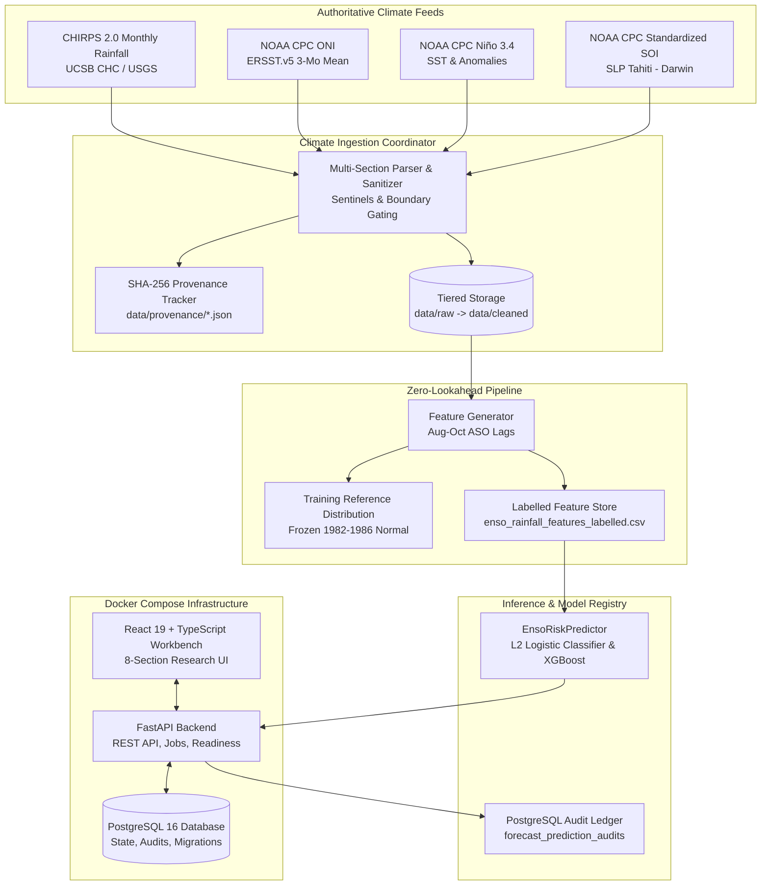

# ENSO Shield

**Cyber-Resilient Climate-Risk Intelligence & Anticipatory Action Platform for Southern Africa**

[](https://www.python.org/)
[](https://fastapi.tiangolo.com/)
[](https://react.dev/)
[](https://www.typescriptlang.org/)
[](https://www.postgresql.org/)
[]()
[](LICENSE)

---

## Executive Summary

**ENSO Shield** is a research-backed, cyber-resilient seasonal climate-risk assessment and anticipatory action platform focused on the **El Niño–Southern Oscillation (ENSO)** teleconnection and its impacts on austral summer convective precipitation across **Southern Africa**.

The platform is designed to provide transparent, defensible, and empirically verifiable climate intelligence to institutional disaster risk managers, agricultural extension directors, water catchment agencies, and meteorological collaborators.

### Key Capabilities

1. **Zero-Lookahead Teleconnection Modeling:** Strict November 1st forecast issue date pairing antecedent August–October (ASO) Pacific SST anomalies (ONI, Niño 3.4) and Southern Oscillation Index (SOI) with summer convective rainfall ($P_Y = \text{Dec}_{Y-1} + \text{Jan}_Y + \text{Feb}_Y$).
2. **Defensible Scientific Inputs:** Strictly rejects arbitrary heuristic conversions. Operational forecasts require verified observed inputs from authoritative datasets; hypothetical scenarios require physically consistent rainfall depths ($P_{\text{spring}} \ge P_{\text{oct}}$).
3. **Persistent Anticipatory Action Workflows:** Full finite state machine (`MONITORING` $\rightarrow$ `READY` $\rightarrow$ `TRIGGERED` $\rightarrow$ `EXECUTED`) backed by PostgreSQL with `SELECT ... FOR UPDATE` row-level concurrency locking and immutable audit logs.
4. **Cryptographic SHA-256 Provenance Ledger:** 4-pillar data integrity architecture tracking raw hashes, transformation lineage, digital signatures, and provenance manifests.
5. **Epistemic Triad Risk Synthesis:** Tripartite decision-support synthesizing (a) empirical baseline probabilities, (b) climatological frequency benchmarks, and (c) heuristic sensitivity bands.

---

## System Architecture



---

## Repository Layout

```text
├── apps/
│   └── web/                   # React 19 + TypeScript 5.7 workbench (Vite, CSS Modules)
│       ├── src/views/         # 8 analytical views (Dashboard, Forecasts, Preparedness, etc.)
│       └── src/components/    # Accessible visualization components & Waterfall charts
├── services/
│   └── api/                   # FastAPI backend application (Python 3.12+)
│       ├── src/enso_api/      # Core API routes, db connection pool, background scheduler
│       └── tests/             # Backend pytest suite (96 tests)
├── ml/
│   ├── data/                  # Ingestion adapters, pipeline coordination, validators
│   ├── features/              # Zero-lookahead feature extraction & reference distribution
│   ├── training/              # Model training, expanding-window rolling-origin CV
│   ├── evaluation/            # Brier Score, BSS, Murphy decomposition, calibration metrics
│   ├── experiments/           # Multi-model benchmarks (XGBoost vs Logistic vs Climatology)
│   ├── inference/             # EnsoRiskPredictor runtime engine & schema validation
│   └── registry/              # Model manifest serialization, digital signatures & quarantine
├── infrastructure/
│   └── database/              # PostgreSQL init.sql and additive migrations (0001-0004)
├── data/
│   ├── raw/                   # Raw climate text & ASCII feeds
│   ├── cleaned/               # Authoritative monthly cleaned datasets (*_monthly.csv)
│   ├── features/              # Analysis-ready labelled feature store & data dictionaries
│   ├── fixtures/              # Deterministic test fixtures for offline CI/CD
│   └── provenance/            # Cryptographic SHA-256 JSON provenance manifests
├── reports/                   # Machine-readable evaluation manifests & ablation benchmarks
├── research/                  # Research decisions (RD-001 to RD-006) & scientific protocol
├── compose.yaml               # Docker Compose stack (api + web + db)
├── Makefile                   # Cross-platform developer automation commands
└── pyproject.toml             # Python build configuration, ruff & mypy definitions
```

---

## Quick Start & Installation

### Prerequisites

- **Python:** Version 3.12 or higher
- **Node.js:** Version 20 or higher (npm 10+)
- **Docker & Docker Compose:** Optional for containerized deployment (requires $\ge 15\text{ GB}$ free disk space)

### 1. Local Development Setup

```bash
# 1. Clone repository
git clone https://github.com/hosiahledwaba-cmyk/ENSO.git
cd ENSO

# 2. Configure environment file
cp .env.example .env

# 3. Setup Python virtual environment
python -m venv services/api/.venv
# On Windows:
services/api/.venv/Scripts/pip install -e "services/api[dev]"
# On Linux/macOS:
services/api/.venv/bin/pip install -e "services/api[dev]"

# 4. Install Frontend dependencies
npm --prefix apps/web install

# 5. Run automated test suites to verify installation
python -m pytest services/api/tests
npm --prefix apps/web test -- --run
```

### 2. Running Services

```bash
# Start backend API (runs on http://localhost:8000)
# Windows:
& "services/api/.venv/Scripts/uvicorn" enso_api.main:app --host 0.0.0.0 --port 8000 --reload
# Linux/macOS:
./services/api/.venv/bin/uvicorn enso_api.main:app --host 0.0.0.0 --port 8000 --reload

# Start web workbench in another terminal (runs on http://localhost:5173)
npm --prefix apps/web run dev
```

### 3. Containerized Stack (Docker Compose)

```bash
# Build and boot all services (PostgreSQL, API, Web)
docker compose up --build -d

# Check service health
docker compose ps

# Access endpoints:
# Web Workbench:  http://localhost:8080
# Backend API:    http://localhost:8000
# OpenAPI Docs:   http://localhost:8000/docs
```

---

## Anticipatory Action & Preparedness State Machine

ENSO Shield translates probabilistic seasonal risk into concrete, sector-specific anticipatory actions across Agriculture, Water Resources, Livestock, and Disaster Relief.

### Risk Trigger Tiers

| Tier | Probability Range | Operational Posture | Primary Interventions |
| :--- | :---: | :--- | :--- |
| **NORMAL** | $0\% - 25\%$ | Baseline Monitoring | Standard hydrological tracking, seed supply auditing. |
| **ELEVATED** | $25\% - 40\%$ | Readiness Staging | Agro-ecological advisory distribution, borehole sensor inspection. |
| **HIGH** | $40\% - 60\%$ | Anticipatory Trigger | Sorghum/millet seed vouchers, irrigation quota adjustments, destocking setup. |
| **CRITICAL** | $> 60\%$ | Emergency Prepositioning | Emergency social grant top-ups, bulk water tanker prepositioning. |

### Finite State Machine & Concurrency Control

Action execution state is stored in PostgreSQL table `preparedness_action_states` and updated via `SELECT ... FOR UPDATE` row-level locks:

$$\text{MONITORING} \longrightarrow \text{READY} \longrightarrow \text{TRIGGERED} \longrightarrow \text{EXECUTED}$$

> **Epistemic Labeling:** The platform strictly labels action executions as `RECORDED_WORKFLOW_STATE` to distinguish administrative dispatch authorization from physical field delivery.

---

## API Endpoints Reference

| Method | Endpoint | Description |
| :--- | :--- | :--- |
| `GET` | `/health` | Service liveness probe. |
| `GET` | `/health/ready` | Service readiness probe (checks database & disk readiness). |
| `GET` | `/api/v1/system/status` | Comprehensive status of pipelines, dataset health, and active jobs. |
| `POST` | `/api/v1/forecast/predict` | Probabilistic seasonal drought inference with factor logit decomposition. |
| `GET` | `/api/v1/forecast/history` | Historical forecast audit ledger. |
| `GET` | `/api/v1/preparedness/actions` | List all anticipatory actions with persisted execution state. |
| `POST` | `/api/v1/preparedness/actions/{id}/trigger` | Atomically advance action status with row lock and audit logging. |
| `GET` | `/api/v1/preparedness/actions/{id}/audit` | Immutable audit trail for an individual action. |
| `GET` | `/api/v1/datasets/coverage` | Ingestion coverage, observation ranges, and checksums. |
| `GET` | `/api/v1/provenance/artefacts` | 4-pillar cryptographic provenance audit results. |
| `GET` | `/api/v1/experiments/latest` | Latest multi-model benchmark manifest and ablation reports. |

---

## Automated Verification & Test Coverage

The platform enforces strict automated regression testing across the entire pipeline:

```bash
# 1. Backend Pytest Suite (96 tests)
& "services/api/.venv/Scripts/python.exe" -m pytest services/api/tests

# 2. Frontend Vitest Suite (48 tests across 11 test suites)
npm --prefix apps/web test -- --run

# 3. Frontend TypeScript Strict Typecheck
npm --prefix apps/web run typecheck

# 4. Production Web Bundle Build
npm --prefix apps/web run build

# 5. Code Quality & Linting
& "services/api/.venv/Scripts/python.exe" -m ruff check services/api
```

**Total Test Count:** **144 automated tests passing** (96 Python backend + 48 React/Vitest frontend).

---

## Scientific Protocols & Research Decisions

The implementation follows formal Research Decisions documented in [`research/`](file:///c:/myworkspaces/projects/ENSO/research):

- **RD-001:** Definition of the convective austral summer target season ($P_Y = \text{Dec}_{Y-1} + \text{Jan}_Y + \text{Feb}_Y$).
- **RD-002:** Strict zero-lookahead November 1st forecast boundary.
- **RD-003:** Freezing the reference climatology to the historical training baseline to avoid test contamination.
- **RD-004:** Non-negative rainfall constraint enforcement ($P_{\text{spring}} \ge P_{\text{oct}}$).
- **RD-005:** Disclosure of small-sample variance limitations ($N=5$) and rejection of uncalibrated asymptotic covariance intervals.
- **RD-006:** Cryptographic SHA-256 provenance manifests for all analysis-ready datasets.

---

## License

This project is released under the **MIT License**. Climate data from NOAA CPC and CHIRPS are subject to their respective government and institutional open-access data redistribution policies.
